# Onboarding

Twelve videos in five parts, in the order to watch them. The first two give the whole picture; the next eight follow a
record the way it travels, from the source files into the ingestion tables, from a row to an OSDU record, and into
OSDU; the last two build on it. Each is tagged for whom it serves:
 for building
pipelines with OSDU Delivery, 
for changing the framework itself. Most serve both.

Short on time: watch 01 and 02, then 05 to write a mapping or 12 to change the code. Every video is on the
[deltaforge-org YouTube channel](https://www.youtube.com/@deltaforge-org).

## Start here

Why OSDU Delivery exists, and how its parts fit together.

<table>
<tr>
<td width="38%" valign="top"></td>
<td width="62%" valign="top">
<h3>01 <a href="https://www.youtube.com/watch?v=yffQyPOpJcA">Stop building OSDU ingestion pipelines</a></h3>

3:42 ·  

Why OSDU Delivery exists: one custom loader per data type, replaced by configuration.

</td>
</tr>
<tr>
<td width="38%" valign="top"></td>
<td width="62%" valign="top">
<h3>02 <a href="https://www.youtube.com/watch?v=vxYiGkvaSLs">How OSDU Delivery works</a></h3>

6:18 ·  

The engine and the module, what runs where, and one record through three flows. No coding or OSDU knowledge
needed.

</td>
</tr>
</table>

## Into the ingestion tables

How the source files land and their rows are keyed: only what changed is written, and a new column arrives on its own.

<table>
<tr>
<td width="38%" valign="top"></td>
<td width="62%" valign="top">
<h3>03 <a href="https://www.youtube.com/watch?v=uha2OVcFOBk">How SQLFlow knows what changed</a></h3>

7:12 ·  

The source sends everything and almost nothing changed: the table itself remembers how far a flow got, file and row
fingerprints decide what is new, and a backfill is just another run.

</td>
</tr>
<tr>
<td width="38%" valign="top"></td>
<td width="62%" valign="top">
<h3>04 <a href="https://www.youtube.com/watch?v=Q-5sXYmtnEw">Schema evolution without breaking pipelines</a></h3>

9:43 · 

A new source column flows through the landing and ingestion tables on its own, and an OSDU document changes only
once the mapping takes it up. Columns are added and widened, never dropped or narrowed, and a costly rewrite waits for
approval.

</td>
</tr>
</table>

## From row to record

The mapping that renders an OSDU record from a row, the cache that answers its references, and when a change sends it
again.

<table>
<tr>
<td width="38%" valign="top"></td>
<td width="62%" valign="top">
<h3>05 <a href="https://www.youtube.com/watch?v=k8XU0Boqh4w">Map curated data to OSDU with YAML</a></h3>

17:30 · 

A hands-on mapping tutorial: where each value comes from, references, computed values, rules stated with
<code>$assert</code>, and records held on purpose.

</td>
</tr>
<tr>
<td width="38%" valign="top"></td>
<td width="62%" valign="top">
<h3>06 <a href="https://www.youtube.com/watch?v=xOyhdlTwoRM">Ask once, render many</a></h3>

7:12 ·  

One well log can need more than 40 references, each answered by a versioned cache per partition rather than by
OSDU: how the cache is filled and kept current with <code>cache.before</code> and <code>cache.after</code>, and how a
held record is released once its missing reference appears.

</td>
</tr>
<tr>
<td width="38%" valign="top"></td>
<td width="62%" valign="top">
<h3>07 <a href="https://www.youtube.com/watch?v=t5d1s_9fBGw">Will it send?</a></h3>

9:52 ·  

Change detection in eighteen cases: which source, mapping and cache changes deliver again, which never do, and what
stops a duplicate when runs overlap.

</td>
</tr>
</table>

## Into OSDU

The routes into OSDU, the ledger that accounts for every record sent, and the workers that share the load.

<table>
<tr>
<td width="38%" valign="top"></td>
<td width="62%" valign="top">
<h3>08 <a href="https://www.youtube.com/watch?v=rDVmUhtHHVU">5 doors, 10 routes and silent failures</a></h3>

16:15 ·  

One well log is a record, a file and curve data, and OSDU takes each through its own service: the routes in, and how
a delivery fails while every call answers success.

</td>
</tr>
<tr>
<td width="38%" valign="top"></td>
<td width="62%" valign="top">
<h3>09 <a href="https://www.youtube.com/watch?v=qBJIg7qGZA8">Eight ledger states</a></h3>

13:13 ·  

One well log through its first month: the states a record moves through, held records and their release, reversing
a run, and removing records without a mass deletion.

</td>
</tr>
<tr>
<td width="38%" valign="top"></td>
<td width="62%" valign="top">
<h3>10 <a href="https://www.youtube.com/watch?v=06ZcsDXt2O0">Why 5,000 records ran on one worker</a></h3>

9:52 ·  

Autoscalers count work, not records: a delivery split into parts, the rate limit shared among them, recovery when a
worker fails, and a scale-down that lets running work finish.

</td>
</tr>
</table>

## Build and extend

Let an assistant write the configuration, and find where a change to the framework belongs.

<table>
<tr>
<td width="38%" valign="top"></td>
<td width="62%" valign="top">
<h3>11 <a href="https://www.youtube.com/watch?v=9jOs8EDwBk4">The code doesn't change</a></h3>

8:09 · 

Only the configuration does: an assistant reads the schema, drafts the mapping and opens a pull request, and a
person reviews it.

</td>
</tr>
<tr>
<td width="38%" valign="top"></td>
<td width="62%" valign="top">
<h3>12 <a href="https://www.youtube.com/watch?v=QnOzD6ycfV8">Codebase walkthrough</a></h3>

12:58 · 

<code>osdu/</code> and <code>sqlflow/</code> and the line between them, one CSV row through the real classes, the
ledger's rules, and where a change belongs.

</td>
</tr>
</table>
