# Onboarding

<a href="#the-two-paths-side-by-side"></a>

OSDU Delivery has two kinds of newcomer. A data engineer **configures** it: writes the flows, mappings and templates
that take a source's rows into OSDU, in YAML, in a flow repository of their own, and never touches the engine. A
developer **extends** it: works on the engine itself, in this repository. Both start in the same place. Then the paths
part, and below they run side by side, stage for stage, so each half of a team can see what the other is learning.

## Start here, both paths

<table>
<tr>
<td width="50%" valign="top">
<h3>Why it exists</h3>
<a href="https://www.youtube.com/watch?v=yffQyPOpJcA"></a>
<br><strong><a href="https://www.youtube.com/watch?v=yffQyPOpJcA">Stop building OSDU ingestion pipelines</a></strong> (3:42). One loader per data type, against configuration.
</td>
<td width="50%" valign="top">
<h3>How it works</h3>
<a href="https://www.youtube.com/watch?v=vxYiGkvaSLs"></a>
<br><strong><a href="https://www.youtube.com/watch?v=vxYiGkvaSLs">Architecture and data flow</a></strong> (6:18). The engine and the module, what runs, and one record through three flows.
</td>
</tr>
</table>

Then run it. One command takes a laptop from nothing to a running OSDU Delivery that has delivered a sample estate and
proved it, against a stand-in for OSDU ([the local demo](osdu/docs/reference/guides/local-demo.md)):

```powershell
# Windows
irm https://raw.githubusercontent.com/TahirRiaz/osdu-delivery/main/bootstrap.ps1 | iex
```

```bash
# macOS and Linux
curl -fsSL https://raw.githubusercontent.com/TahirRiaz/osdu-delivery/main/bootstrap.sh | bash
```

From a checkout, `dev.bat demo` or `./dev.sh demo` does the same.

## Pick your path

<table>
<tr>
<th width="16%"></th>
<th width="42%" align="left">🟠 Configure: use it</th>
<th width="42%" align="left">🔵 Extend: build on it</th>
</tr>
<tr>
<td><b>For</b></td>
<td>Data engineers who deliver a source's data to OSDU</td>
<td>Developers who maintain OSDU Delivery and add to what it can do</td>
</tr>
<tr>
<td><b>You change</b></td>
<td>Flows, mappings, templates and cache flows: YAML in your flow repository</td>
<td>The module under <code>osdu/</code>: C#, its migrations, the GUI, the documentation and the tests</td>
</tr>
<tr>
<td><b>You bring</b></td>
<td>SQL, YAML, and the OSDU kinds you deliver</td>
<td>C# and .NET 9, SQL Server, and TypeScript for the GUI</td>
</tr>
<tr>
<td><b>Done when</b></td>
<td>A new kind of data reaches OSDU, checked and traceable, with no code written</td>
<td>A change lands through a pull request, with its tests and its documentation</td>
</tr>
</table>

## The two paths, side by side

Each stage pairs one step of each path. A step has a video or a hands-on task, the pages that go deeper, and something
to do before moving on.

<table>
<tr>
<th width="50%" align="left">🟠 Configure: build pipelines with OSDU Delivery</th>
<th width="50%" align="left">🔵 Extend: maintain and grow the framework</th>
</tr>

<tr><th colspan="2">1 · Orient</th></tr>
<tr>
<td width="50%" valign="top">
<a href="https://www.youtube.com/watch?v=rDVmUhtHHVU"></a>
<h3>01 Every route into OSDU</h3>
<p><a href="https://www.youtube.com/watch?v=rDVmUhtHHVU"><b>5 doors, 10 routes and silent failures</b></a> (16:15)</p>
<p>One well log is a record, a file and curve data, and OSDU takes each through its own service. The doors, the ten
routes, and the ways a delivery goes wrong while every call answers success.</p>
<p><b>Read</b> <a href="osdu/docs/reference/flow/routes.md">Routes</a>, <a href="osdu/docs/reference/flow/ddms.md">DDMSs</a>, <a href="docs/osdu-coverage-plan.md">the coverage plan</a></p>
<p><b>Do</b> Find the kinds you deliver in the coverage plan's second section, and the route that serves each.</p>
</td>
<td width="50%" valign="top">
<a href="https://www.youtube.com/watch?v=QnOzD6ycfV8"></a>
<h3>01 Codebase walkthrough</h3>
<p><a href="https://www.youtube.com/watch?v=QnOzD6ycfV8"><b>Architecture and where to make changes</b></a> (12:58)</p>
<p><code>osdu/</code> and <code>sqlflow/</code> and the line between them, eight projects and four hosts, one CSV row
through the real classes, the ledger's rules and the tables behind them.</p>
<p><b>Read</b> <a href="osdu/README.md">osdu/README.md</a>, <a href="osdu/docs/reference/concepts/architecture.md">Architecture</a></p>
<p><b>Do</b> Open <code>AddDeliveryKind</code> in <code>osdu/src/SqlFlow.Delivery/Engine/DeliveryServices.cs</code>, the
composition root, and follow what it registers.</p>
</td>
</tr>

<tr><th colspan="2">2 · Set up</th></tr>
<tr>
<td width="50%" valign="top">
<h3>02 Your own estate</h3>
<p>Point a local run at your SQL Server, your OSDU partition and your flow repository. The first start asks for each,
tests the sign-in, and writes the git-ignored <code>.sqlflow/env</code>. Then build one delivery by hand, from source
files to a wellbore record in OSDU.</p>
<p><b>Read</b> <a href="osdu/docs/reference/guides/run-locally.md">Run it locally</a>, <a href="osdu/docs/reference/guides/getting-started.md">Your first delivery</a>, <a href="osdu/docs/reference/guides/welldb-sample.md">The welldb sample</a></p>
<p><b>Do</b> Start it from a checkout:</p>
<pre>dev.bat      # Windows
./dev.sh     # macOS, Linux</pre>
</td>
<td width="50%" valign="top">
<h3>02 Your development machine</h3>
<p>.NET 9, Node.js 22 and a SQL Server. The unit tier needs no database and runs before every push; the full tier runs
every suite against SQL Server, on <code>main</code> once a pull request lands.</p>
<p><b>Read</b> <a href="CONTRIBUTING.md">CONTRIBUTING.md</a>, <a href="CLAUDE.md">CLAUDE.md</a> (the rules every change
follows), <a href="CONTRIBUTING.md#tests">the test tiers</a></p>
<p><b>Do</b> Install the pre-push hook and run the unit tier:</p>
<pre>bash tools/test.sh --install-hook
bash tools/test.sh</pre>
</td>
</tr>

<tr><th colspan="2">3 · Build</th></tr>
<tr>
<td width="50%" valign="top">
<a href="https://www.youtube.com/watch?v=k8XU0Boqh4w"></a>
<h3>03 Write a mapping</h3>
<p><a href="https://www.youtube.com/watch?v=k8XU0Boqh4w"><b>Map curated data to OSDU with YAML</b></a> (17:30)</p>
<p>How a row becomes an OSDU document: where each value comes from, references through the cache and search, computed
values and conditions, rules stated with <code>$assert</code>, and records held on purpose.</p>
<p><b>Read</b> <a href="osdu/docs/reference/guides/writing-a-mapping.md">Writing a mapping</a>, <a href="osdu/docs/reference/flow/mapping-transformations.md">Mapping transformations</a>, <a href="osdu/docs/reference/flow/mapping.md">The mapping document</a></p>
<p><b>Do</b> Run the loop on your flow until it is clean. None of it sends anything:</p>
<pre>sqlflow check   &lt;flow&gt;.yaml
sqlflow values  &lt;flow&gt;.yaml
sqlflow preview &lt;flow&gt;.yaml --key &lt;key&gt;</pre>
</td>
<td width="50%" valign="top">
<h3>03 One row into the ledger</h3>
<p>A run plans, renders, sends and records. <code>DeliveryExecutor</code> plans, <code>ChangeDetector</code> decides
what changed, <code>MappingRenderer</code> renders, <code>DeliveryWorker</code> sends through an
<code>IDeliveryProtocol</code>, and every outcome is written through <code>ILedger</code>. Nothing goes around the
ledger.</p>
<p><b>Watch</b> <a href="https://www.youtube.com/watch?v=QnOzD6ycfV8&t=259s">Follow one row through a run</a> (4:19)
and <a href="https://www.youtube.com/watch?v=QnOzD6ycfV8&t=329s">The ledger is the product</a> (5:29)</p>
<p><b>Read</b> <a href="osdu/docs/reference/concepts/ledger.md">The ledger</a>, <a href="osdu/docs/reference/concepts/submissions.md">Submissions, work batches and leases</a>, <a href="osdu/docs/reference/concepts/database.md">The osdu schema</a></p>
<p><b>Do</b> Read <code>osdu/src/SqlFlow.Delivery/Ledger/ILedger.cs</code>, the one way in to the ledger.</p>
</td>
</tr>

<tr><th colspan="2">4 · Change</th></tr>
<tr>
<td width="50%" valign="top">
<a href="https://www.youtube.com/watch?v=LA4qjIsUcYU"></a>
<h3>04 When the source changes</h3>
<p><a href="https://www.youtube.com/watch?v=LA4qjIsUcYU"><b>One new column, zero manual migrations</b></a> (9:52)</p>
<p>A new column flows through the landing and ingestion tables on its own, and an OSDU document changes only once the
mapping takes it up. Then <a href="https://www.youtube.com/watch?v=t5d1s_9fBGw">Will it send?</a> (9:52) shows which
source and mapping changes deliver again, and which never do.</p>
<p><b>Read</b> <a href="sqlflow/docs/reference/concepts/schema-evolution.md">Schema evolution</a>, <a href="osdu/docs/reference/concepts/change-detection.md">Change detection</a></p>
<p><b>Do</b> See what a change would do before it does it: the DDL a landing flow would run, then what a delivery
would send.</p>
<pre>sqlflow plan &lt;landing flow&gt;.yaml
sqlflow run  &lt;delivery flow&gt;.yaml --operation plan</pre>
</td>
<td width="50%" valign="top">
<a href="https://www.youtube.com/watch?v=t5d1s_9fBGw"></a>
<h3>04 Will it send?</h3>
<p><a href="https://www.youtube.com/watch?v=t5d1s_9fBGw"><b>Change detection, in eighteen cases</b></a> (9:52)</p>
<p>Delivery receipts and fingerprints, source and mapping changes, stale records and deletions, cache dependencies and
approvals, and the last check that stops a duplicate when runs overlap.</p>
<p><b>Read</b> <a href="osdu/docs/reference/concepts/change-detection.md">Change detection</a>, <a href="osdu/docs/reference/concepts/preflight.md">Preflight</a></p>
<p><b>Do</b> Read <code>osdu/src/SqlFlow.Delivery/Planning/ChangeDetector.cs</code> with
<a href="https://www.youtube.com/watch?v=t5d1s_9fBGw&t=544s">Exploring the change detector</a> (9:04) beside it.</p>
</td>
</tr>

<tr><th colspan="2">5 · Run</th></tr>
<tr>
<td width="50%" valign="top">
<a href="https://www.youtube.com/watch?v=qBJIg7qGZA8"></a>
<h3>05 Where is my record?</h3>
<p><a href="https://www.youtube.com/watch?v=qBJIg7qGZA8"><b>Eight ledger states</b></a> (13:13)</p>
<p>One well log through its first month: the eight states a record moves through, retries and issues, held records and
their release, reversing a run, and removing records without a mass deletion.</p>
<p><b>Read</b> <a href="osdu/docs/reference/concepts/record-lifecycle.md">Record lifecycle</a>, <a href="osdu/docs/reference/guides/operations-runbook.md">Operations runbook</a>, <a href="osdu/docs/reference/guides/data-quality-tests.md">Testing what OSDU holds</a></p>
<p><b>Do</b> Find what is held, and why:</p>
<pre>sqlflow records list &lt;flow&gt;.yaml --status held
sqlflow records show &lt;flow&gt;.yaml --key &lt;key&gt;</pre>
</td>
<td width="50%" valign="top">
<a href="https://www.youtube.com/watch?v=06ZcsDXt2O0"></a>
<h3>05 One worker, then six</h3>
<p><a href="https://www.youtube.com/watch?v=06ZcsDXt2O0"><b>Why 5,000 records ran on one worker</b></a> (9:52)</p>
<p>Autoscalers count work, not records: a worker's four slots, a large delivery split into parts that run on their
own, the rate limit shared out among them, recovery when a worker fails, and a scale-down that lets running work
finish.</p>
<p><b>Read</b> <a href="osdu/docs/reference/guides/managed-workers.md">Managed workers</a>, <a href="osdu/docs/reference/flow/delivery.md#parallelism">parallelism</a>, <a href="osdu/docs/wiki/decisions/0025-parallelism-and-default-fan-out.md">decision 0025</a></p>
<p><b>Do</b> Start <code>dev.bat</code> or <code>./dev.sh</code> and run a delivery: the control plane starts and stops
its own worker processes, and the Nodes page shows it scale.</p>
</td>
</tr>

<tr><th colspan="2">6 · Grow</th></tr>
<tr>
<td width="50%" valign="top">
<a href="https://www.youtube.com/watch?v=9jOs8EDwBk4"></a>
<h3>06 Build with the assistant</h3>
<p><a href="https://www.youtube.com/watch?v=9jOs8EDwBk4"><b>The code doesn't change</b></a> (8:09)</p>
<p>Only the configuration does. An assistant reads the schema, drafts the mapping, checks it and opens a pull request;
a person reviews it, and the engine that runs it is the tested one.</p>
<p><b>Read</b> <a href="osdu/docs/reference/guides/mcp.md">The MCP server</a>, <a href="osdu/docs/reference/guides/vscode.md">The VS Code extension</a></p>
<p><b>Do</b> Connect your assistant: <code>osdu-delivery-mcp install claude</code> prints its registration
(<a href="osdu/docs/reference/guides/mcp.md#installing-it-for-a-person">installing it</a>), or the VS Code extension
registers it for you.</p>
</td>
<td width="50%" valign="top">
<h3>06 The extension ladder</h3>
<p>Stay on the lowest rung that does the job
(<a href="https://www.youtube.com/watch?v=QnOzD6ycfV8&t=535s">The ladder</a>, 8:55):</p>
<ol>
<li><b>Configuration</b>: a template, a mapping and a flow, for a new kind on a route that already serves it</li>
<li><b>Listener</b>: an <code>IDeliveryListener</code> hears every outcome once the ledger has written it</li>
<li><b>Shape</b>: an <code>IDdmsShape</code> for another domain data management service; there are six</li>
<li><b>Route</b>: a <code>DeliveryProtocol</code> member, an <code>IDeliveryProtocol</code> and its arm in
<code>ProtocolFactory</code>, with the service's contract pinned in <a href="osdu/specs">osdu/specs</a> first; there
are ten</li>
<li><b>Flow kind</b>: an <code>IFlowDocumentKind</code> and an <code>IFlowDocumentExecutor</code> registered in
<code>AddDeliveryKind</code>, then every layer: API, CLI, GUI and docs</li>
<li><b><code>sqlflow/</code></b>: a generic extension point any module could use, in a <code>sqlflow:</code> commit of
its own, with its row in <a href="docs/sqlflow-changes.md">docs/sqlflow-changes.md</a></li>
</ol>
<p><b>Read</b> <a href="osdu/docs/reference/concepts/protocols.md">Protocols</a>, <a href="osdu/docs/reference/flow/ddms-services.md">DDMS shapes and services</a></p>
<p><b>Do</b> See everything one flow kind took, in bash or PowerShell (it ends <code>64 files changed</code>):</p>
<pre>git show --stat --oneline $(git log --format=%h --diff-filter=A -- '*DownloadFlowKind.cs')</pre>
</td>
</tr>

<tr><th colspan="2">7 · Ship</th></tr>
<tr>
<td width="50%" valign="top">
<h3>07 Deliver to dev, test and prod</h3>
<p>The same flows run in every environment. A deployment names its partitions and a run picks one; schedules kept in
the repository run the flows in order; failures notify. A fresh deployment starts from its configuration alone.</p>
<p><b>Read</b> <a href="osdu/docs/reference/concepts/partitions.md">Partitions</a>, <a href="osdu/docs/reference/guides/deployment.md">Deployment</a>, <a href="osdu/docs/reference/guides/notifications.md">Notifications</a></p>
<p><b>Do</b> List the partitions your runs can deliver to:</p>
<pre>sqlflow partition list</pre>
</td>
<td width="50%" valign="top">
<h3>07 Land a change</h3>
<p>A branch from <code>main</code>, commits whose subjects say what the repository now does, a pull request with its
tests and documentation, the checks green and one review, then rebase and merge. The full tier runs on
<code>main</code> straight after.</p>
<p><b>Read</b> <a href="CONTRIBUTING.md#how-work-reaches-main">How work reaches main</a>, <a href="CHANGELOG.md">the changelog</a>, <a href="osdu/docs/wiki/index.md">the wiki</a> (why it is this way)</p>
<p><b>Do</b> Run the checks CI runs, before you push:</p>
<pre>bash tools/check-vendored-sqlflow.sh
bash tools/check-conventions.sh origin/main HEAD</pre>
</td>
</tr>
</table>

## Where the answers are

| Question | Where |
| --- | --- |
| What does it do? | [The reference](osdu/docs/reference/README.md): every flow, mapping key, command, concept and table |
| Why is it this way? | [The wiki](osdu/docs/wiki/index.md): the decisions, with what was rejected |
| How do I solve this delivery problem? | [The pattern catalog](osdu/docs/wiki/maps/pattern-catalog.md): a problem, the shape that solves it, its page |
| What does the engine underneath do? | [SQLFlow's reference](sqlflow/docs/reference/README.md): landing files, ingestion, schedules, lineage, secrets |
| Can I just ask? | [The MCP server](osdu/docs/reference/guides/mcp.md) searches all of the above for your assistant |

## Every video

| Video | Length | Step |
| --- | --- | --- |
| [Stop building OSDU ingestion pipelines](https://www.youtube.com/watch?v=yffQyPOpJcA) | 3:42 | Start here |
| [Architecture and data flow](https://www.youtube.com/watch?v=vxYiGkvaSLs) | 6:18 | Start here |
| [5 doors, 10 routes and silent failures](https://www.youtube.com/watch?v=rDVmUhtHHVU) | 16:15 | 🟠 01 |
| [Codebase walkthrough](https://www.youtube.com/watch?v=QnOzD6ycfV8) | 12:58 | 🔵 01, 03, 06 |
| [Map curated data to OSDU with YAML](https://www.youtube.com/watch?v=k8XU0Boqh4w) | 17:30 | 🟠 03 |
| [One new column, zero manual migrations](https://www.youtube.com/watch?v=LA4qjIsUcYU) | 9:52 | 🟠 04 |
| [Will it send? Change detection](https://www.youtube.com/watch?v=t5d1s_9fBGw) | 9:52 | 🔵 04, 🟠 04 |
| [Eight ledger states](https://www.youtube.com/watch?v=qBJIg7qGZA8) | 13:13 | 🟠 05 |
| [Why 5,000 records ran on one worker](https://www.youtube.com/watch?v=06ZcsDXt2O0) | 9:52 | 🔵 05 |
| [The code doesn't change: AI-driven pipelines](https://www.youtube.com/watch?v=9jOs8EDwBk4) | 8:09 | 🟠 06 |
