# OSDU Delivery

[](LICENSE)
[](https://dotnet.microsoft.com/)

**Get any data into OSDU. Configured, not coded.**

Wells, logs, seismic, production data and more: delivered, kept in sync, and traceable record by record.

[OSDU](https://osduforum.org/) is the open data platform of the energy industry. Every type of data it holds has its own
schema, codes and services, so most teams write and maintain a custom loader for each one. OSDU Delivery replaces those
loaders with configuration.

## Introduction and architecture

<table>
<tr>
<td width="50%" valign="top">
<h3>Why it exists</h3>
<a href="https://www.youtube.com/watch?v=yffQyPOpJcA"></a>
<br><strong><a href="https://www.youtube.com/watch?v=yffQyPOpJcA">Stop building OSDU ingestion pipelines</a></strong> (3:42). Start here.
</td>
<td width="50%" valign="top">
<h3>How it works</h3>
<a href="https://www.youtube.com/watch?v=vxYiGkvaSLs"></a>
<br><strong><a href="https://www.youtube.com/watch?v=vxYiGkvaSLs">Architecture and data flow</a></strong> (6:18). No coding or OSDU knowledge needed.
</td>
</tr>
</table>

## What you get

- **Every OSDU write path.** Storage, file and dataset services, manifest and workflow ingestion, and the domain data
  stores for wellbores, seismic, samples, well delivery, production and reservoir models
  ([coverage plan](docs/osdu-coverage-plan.md)).
- **Safe to rerun.** The same row always becomes the same record, and only what changed is sent.
- **Checked before sending.** Mappings against their schema, legal tags against OSDU, and records before they go out.
- **Every record accounted for.** Nothing reaches OSDU except through the
  [ledger](osdu/docs/reference/concepts/ledger.md), which finds any record by key, OSDU id or source file.
- **After delivery.** Verify against OSDU, explore what it holds, and correct with removals and redeliveries, every
  action recorded.
- **Runs near your data.** Workers fetch their work, so they can run inside the network that holds your data.
- **One configuration, every environment.** The same flows run in dev, test and prod.
- **An AI assistant that builds it with you.** Ask for a new data type and it reads the schema, drafts the mapping and
  opens a pull request for a person to review. It works from definitions and delivery metadata, and reads data only
  when asked, over what an approved AI context opens ([MCP guide](osdu/docs/reference/guides/mcp.md)).

## Try it

One command takes a laptop from nothing to a running OSDU Delivery that has delivered a sample estate and proved it. You
need no OSDU: a stand-in runs on the machine, and everything else is the real product.

```powershell
# Windows
irm https://raw.githubusercontent.com/TahirRiaz/osdu-delivery/main/bootstrap.ps1 | iex
```

```bash
# macOS and Linux
curl -fsSL https://raw.githubusercontent.com/TahirRiaz/osdu-delivery/main/bootstrap.sh | bash
```

From a checkout, `dev.bat demo` or `./dev.sh demo` does the same. It needs a SQL Server, or Docker Desktop running to
start one ([the local demo](osdu/docs/reference/guides/local-demo.md)).

## Onboarding

<a href="ONBOARDING.md"></a>

**[Ten videos](ONBOARDING.md)** in the order to watch them, each with a short description and tagged for data
engineers, for extending the framework, or both.

## Learn more

- [Your first delivery](osdu/docs/reference/guides/getting-started.md): build one from scratch
- [Run it locally](osdu/docs/reference/guides/run-locally.md): with your own SQL Server, OSDU and flow repository
- [Welldb sample](osdu/docs/reference/guides/welldb-sample.md): an empty partition filled, up to well logs and curves
- [Reference documentation](osdu/docs/reference/README.md): every flow, mapping key, command and concept
- [Mapping transformations](osdu/docs/reference/flow/mapping-transformations.md): every function, modifier and lookup
- [Deployment](osdu/docs/reference/guides/deployment.md): Docker Compose, Kubernetes, Azure Bicep, Terraform and Radix
- [Architecture](osdu/docs/reference/concepts/architecture.md): the components, the databases and how they fit
- [Wiki](osdu/docs/wiki/index.md): why it is this way

## Status

Verified against a live OSDU (Azure Data Manager for Energy 0.29, September 2026) through the storage, file, manifest
ingestion and Wellbore DDMS paths. Every write path is tested against OSDU's own service contracts, pinned in
[osdu/specs](osdu/specs). Recent changes are in the [changelog](CHANGELOG.md).

## Contributing

The [onboarding](ONBOARDING.md) videos tagged extending are the way in. [CONTRIBUTING.md](CONTRIBUTING.md) sets up a
development machine and runs the tests, and [osdu/README.md](osdu/README.md) maps the module's code. OSDU Delivery is
built on [SQLFlow](https://github.com/TahirRiaz/SQLFlow), kept in [sqlflow/](sqlflow/), which is why its command line
is `sqlflow`.

## License and contact

Licensed under the GNU General Public License v3.0 ([LICENSE](LICENSE)).

Questions, bugs and feature requests: **[tahir@sqlflow.io](mailto:tahir@sqlflow.io)** or an issue on the repository.
Security reports go by email or a private security advisory, never a public issue ([SECURITY.md](SECURITY.md)).
