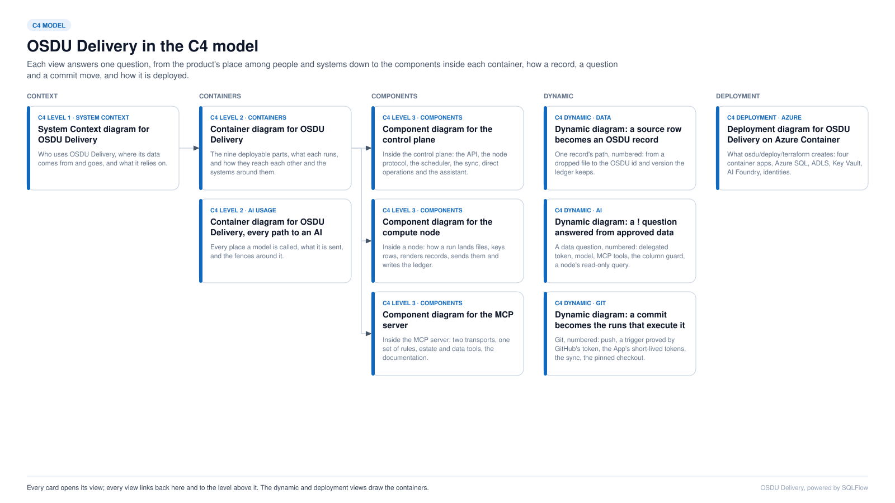

# Architecture diagrams: OSDU Delivery in the C4 model

<!-- Generated by tools/c4/render.py from osdu/docs/reference/architecture/c4-model.yaml. Edit the model and render again. -->

OSDU Delivery drawn in the [C4 model](https://c4model.com): a system context, the containers inside it, the components
inside the three containers that hold its logic, three dynamic views of how a record, a question and a commit move
through them, and the deployment the Terraform in `osdu/deploy/terraform` creates on Azure. Every diagram follows the
notation's checklist: a title naming the diagram's type and scope, every element with its name, its type and
technology and what it does, every line with what it does and how, and a key to every colour, shape, icon, border and
line style it uses.

The diagrams, these pages and the deck are drawn from one model,
[c4-model.yaml](c4-model.yaml), by [tools/c4/render.py](../../../../tools/c4/render.py): an element is described once
and every view that shows it shows the same thing. Change the model and render again; never edit an SVG or a page by
hand. How the module meets SQLFlow underneath is [the architecture page](../concepts/architecture.md).

| View | Level | What it answers |
| --- | --- | --- |
| [System Context diagram for OSDU Delivery](system-context.md) | C4 Level 1 · System Context | Who uses OSDU Delivery, where its data comes from and goes, and what it relies on. |
| [Container diagram for OSDU Delivery](containers.md) | C4 Level 2 · Containers | The nine deployable parts, what each runs, and how they reach each other and the systems around them. |
| [Container diagram for OSDU Delivery, every path to an AI model](ai-usage.md) | C4 Level 2 · AI Usage | Every place a model is called, what it is sent, and the fences around it. |
| [Component diagram for the control plane](control-plane.md) | C4 Level 3 · Components | Inside the control plane: the API, the node protocol, the scheduler, the sync, direct operations and the assistant. |
| [Component diagram for the compute node](compute-node.md) | C4 Level 3 · Components | Inside a node: how a run lands files, keys rows, renders records, sends them and writes the ledger. |
| [Component diagram for the MCP server](mcp-server.md) | C4 Level 3 · Components | Inside the MCP server: two transports, one set of rules, estate and data tools, the documentation. |
| [Dynamic diagram: a source row becomes an OSDU record](record-delivery.md) | C4 Dynamic · Data | One record's path, numbered: from a dropped file to the OSDU id and version the ledger keeps. |
| [Dynamic diagram: a ! question answered from approved data](question.md) | C4 Dynamic · AI | A data question, numbered: delegated token, model, MCP tools, the column guard, a node's read-only query. |
| [Dynamic diagram: a commit becomes the runs that execute it](git-integration.md) | C4 Dynamic · Git | Git, numbered: push, a trigger proved by GitHub's token, the App's short-lived tokens, the sync, the pinned checkout. |
| [Deployment diagram for OSDU Delivery on Azure Container Apps](deployment-azure.md) | C4 Deployment · Azure | What osdu/deploy/terraform creates: four container apps, Azure SQL, ADLS, Key Vault, AI Foundry, identities. |

A view marked *view inside* on an element links to the view of what is inside it: on these pages through the tables,
in the SVG files when they are opened on their own, and on the slides by a click.

The same views as a deck: [osdu-delivery-c4.pptx](osdu-delivery-c4.pptx), one slide a view, each element on a slide a link to the view that zooms into it.

## See also

- [Architecture: the OSDU module on SQLFlow](../concepts/architecture.md)
- [AI in OSDU Delivery](../concepts/ai-features.md)
- [Deploying OSDU Delivery](../guides/deployment.md)
